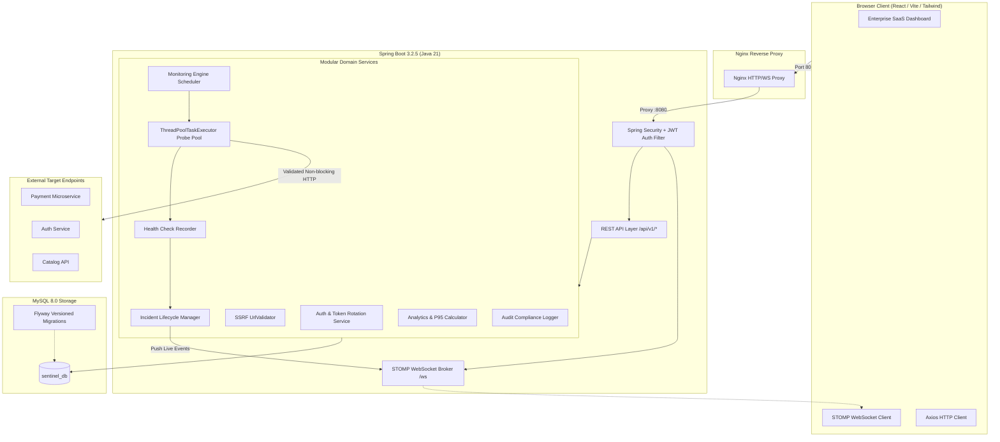
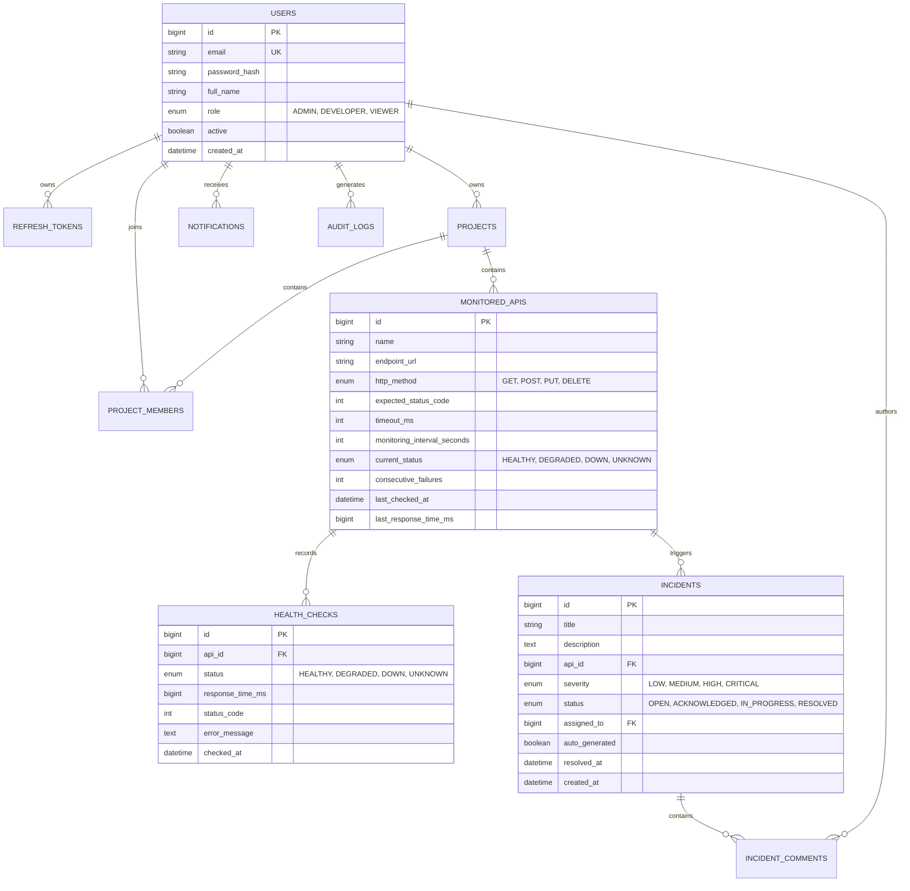

# Sentinel – Enterprise API Monitoring & Incident Management Platform

[](https://github.com/your-org/sentinel-api-monitoring/actions/workflows/ci.yml)
[](https://www.oracle.com/java/technologies/downloads/#java21)
[](https://spring.io/projects/spring-boot)
[](https://www.mysql.com/)
[](https://react.dev/)
[](https://www.typescriptlang.org/)
[](https://tailwindcss.com/)
[](https://opensource.org/licenses/MIT)

---

## 1. Executive Summary & Problem Statement

Modern enterprise platforms rely on distributed microservices and third-party APIs (payment gateways, authentication providers, logistics APIs, notification engines). When an API experiences latency spikes, intermittent failures, or outright downtime:
- Engineering teams face delayed outage discovery.
- Root cause analysis is fragmented across multiple logging portals.
- SLA breaches occur without timely notification.

**Sentinel** is a centralized, production-grade observability platform designed to continuously probe registered APIs, detect anomalies and connection timeouts, trigger automated incident tickets with strict duplicate prevention, alert on-call developers, and provide real-time uptime analytics.

---

## 2. Key Features

- **Continuous Synthetic Probing:**
  - Automated scheduling via Spring Scheduler & non-blocking `ThreadPoolTaskExecutor`.
  - Configurable probe intervals (10s – 86400s) and per-endpoint timeouts.
  - Multi-method support: `GET`, `POST`, `PUT`, `DELETE`.
  - Overlap prevention: in-memory lock table avoids cascading concurrent probes for sluggish endpoints.
- **SSRF Defense Guard:**
  - Automated URL sanitization rejecting loopback addresses (`127.0.0.1`, `localhost`), link-local IPs, RFC-1918 private subnets, and cloud metadata endpoints (`169.254.169.254`).
- **Automated Incident Triage & Deduplication:**
  - Policy: 3 consecutive failed health checks automatically promote an alert to a **HIGH** severity incident.
  - De-duplication: active outages suppress duplicate ticket creation.
  - Automatic resolution: when an API recovers, open auto-generated incidents are automatically marked `RESOLVED`.
- **Live Observability Stream:**
  - WebSocket (STOMP over SockJS) streams instant probe failures, latency measurements, and incident assignments to active browser clients.
- **Role-Based Access Control (RBAC):**
  - Granular permissions for `ADMIN`, `DEVELOPER`, and `VIEWER` roles.
  - BCrypt password hashing & JWT authentication with automated refresh-token rotation and revocation.
- **Audit & Compliance Logging:**
  - Immutable audit logs capture user logins, API mutations, project management, and incident triage.
- **Enterprise Analytics:**
  - Real-time SLA compliance, uptime percentage calculations, latency percentiles (**P95**, Min, Max, Mean), daily availability graphs, and weekly/monthly reporting.

---

## 3. Technology Stack

| Layer | Technologies |
|---|---|
| **Backend Core** | Java 21, Spring Boot 3.2.5, Spring MVC, Spring Security, Spring Data JPA, Hibernate 6 |
| **Authentication** | JWT (`io.jsonwebtoken 0.12.5`), BCrypt, Refresh-Token Rotation |
| **Concurrency & Async** | Spring `@EnableScheduling`, `ThreadPoolTaskExecutor`, CompletableFuture |
| **Real-time Messaging** | Spring WebSocket, STOMP Broker, SockJS |
| **Persistence & Migration** | MySQL 8.0, HikariCP, Flyway Database Migrations (`flyway-mysql`) |
| **Frontend Framework** | React 18, TypeScript, Vite, Tailwind CSS, Lucide React Icons |
| **Data Visualization** | Recharts (Responsive Line & Donut Charts) |
| **Testing** | JUnit 5, Mockito, Spring Security Test, H2 In-Memory Database |
| **Containerization & CI** | Docker, Docker Compose, Nginx, GitHub Actions |

---

## 4. System Architecture



---

## 5. Database Schema & ER Diagram



---

## 6. REST API Endpoints Specification

Base URL: `/api/v1`

### Authentication
| Method | Endpoint | Description | Access |
|---|---|---|---|
| `POST` | `/auth/register` | Register a new user | Public |
| `POST` | `/auth/login` | Authenticate user & issue tokens | Public |
| `POST` | `/auth/refresh` | Refresh access token using refresh token | Public |
| `POST` | `/auth/logout` | Revoke tokens & destroy session | Authenticated |
| `GET` | `/auth/me` | Retrieve profile of authenticated user | Authenticated |

### Projects
| Method | Endpoint | Description | Access |
|---|---|---|---|
| `POST` | `/projects` | Create a new project workspace | Admin, Developer |
| `GET` | `/projects` | List accessible projects | Authenticated |
| `GET` | `/projects/{id}` | Get project details & team members | Authenticated |
| `PUT` | `/projects/{id}` | Update project metadata | Admin, Developer |
| `DELETE` | `/projects/{id}` | Deactivate project workspace | Admin, Developer |
| `POST` | `/projects/{id}/members` | Add team members to project | Admin, Developer |
| `DELETE` | `/projects/{id}/members/{userId}` | Remove member from project | Admin, Developer |

### Monitored APIs
| Method | Endpoint | Description | Access |
|---|---|---|---|
| `POST` | `/apis` | Register endpoint for monitoring (SSRF validated) | Admin, Developer |
| `GET` | `/apis` | List monitored APIs with pagination & search | Authenticated |
| `GET` | `/apis/{id}` | Get API configuration & telemetry | Authenticated |
| `PUT` | `/apis/{id}` | Update API monitoring configurations | Admin, Developer |
| `DELETE` | `/apis/{id}` | Remove monitored API | Admin, Developer |
| `PATCH` | `/apis/{id}/toggle` | Pause or resume monitoring probe | Admin, Developer |
| `POST` | `/apis/{id}/check` | Dispatch manual health probe immediately | Admin, Developer |

### Health Checks & Metrics
| Method | Endpoint | Description | Access |
|---|---|---|---|
| `GET` | `/apis/{id}/health` | Retrieve latest 10 probe results | Authenticated |
| `GET` | `/apis/{id}/history` | Paginated audit trail of health probes | Authenticated |
| `GET` | `/apis/{id}/metrics` | Aggregated SLA uptime & average latency | Authenticated |
| `GET` | `/health-checks` | Global paginated probe log across all APIs | Authenticated |

### Incidents & Triage
| Method | Endpoint | Description | Access |
|---|---|---|---|
| `GET` | `/incidents` | List incidents with status & severity filters | Authenticated |
| `GET` | `/incidents/{id}` | Get incident details, origin & timeline | Authenticated |
| `POST` | `/incidents` | Open manual incident ticket | Admin, Developer |
| `PATCH` | `/incidents/{id}/assign` | Assign incident to an engineer | Admin, Developer |
| `PATCH` | `/incidents/{id}/status` | Transition status (`OPEN`, `ACKNOWLEDGED`, `IN_PROGRESS`, `RESOLVED`) | Admin, Developer |
| `POST` | `/incidents/{id}/comments` | Post investigation note / triage comment | Admin, Developer |
| `GET` | `/incidents/{id}/comments` | List investigation comment history | Authenticated |

### Analytics & Reports
| Method | Endpoint | Description | Access |
|---|---|---|---|
| `GET` | `/dashboard/summary` | Global KPIs: total APIs, healthy/down counts, uptime %, avg latency | Authenticated |
| `GET` | `/dashboard/uptime` | Uptime calculation across date ranges | Authenticated |
| `GET` | `/dashboard/response-time` | Latency statistics and P95 percentile calculation | Authenticated |
| `GET` | `/dashboard/incidents` | Outage frequencies and resolution statistics | Authenticated |
| `GET` | `/reports/weekly` | 7-day executive reliability report | Authenticated |
| `GET` | `/reports/monthly` | 30-day enterprise SLA report | Authenticated |

---

## 7. Quickstart Installation Guide

### Option A: Complete Docker Compose (Recommended)

```bash
# 1. Clone repository
git clone https://github.com/your-org/sentinel-api-monitoring.git
cd sentinel-api-monitoring

# 2. Configure environment
cp .env.example .env

# 3. Launch full stack with Docker Compose
docker compose up --build -d
```

Access the platform:
- **Web UI:** `http://localhost`
- **Default Admin Account:** `admin@sentinel.io` / `Admin@123`
- **Backend API:** `http://localhost:8080/api/v1`
- **Actuator Health:** `http://localhost:8080/api/v1/actuator/health`

### Option B: Local Development Setup

#### 1. Start MySQL 8
Ensure MySQL 8 is running with database `sentinel_db`.

#### 2. Run Backend
```bash
cd backend
mvn clean spring-boot:run
```
Flyway automatically creates all 10 tables and seeds the admin user.

#### 3. Run Frontend
```bash
cd frontend
npm install
npm run dev
```
Open `http://localhost:5173`.

---

## 8. Automated Testing

Sentinel includes a comprehensive test suite covering security, authentication, SSRF protection, monitoring failure policies, deduplication, and P95 latency calculations:

```bash
cd backend
mvn clean test
```

### Test Results Summary:
```
[INFO] Running com.sentinel.analytics.service.AnalyticsServiceTest
[INFO] Tests run: 2, Failures: 0, Errors: 0, Skipped: 0
[INFO] Running com.sentinel.auth.service.AuthServiceTest
[INFO] Tests run: 5, Failures: 0, Errors: 0, Skipped: 0
[INFO] Running com.sentinel.incident.service.IncidentServiceTest
[INFO] Tests run: 3, Failures: 0, Errors: 0, Skipped: 0
[INFO] Running com.sentinel.monitoring.service.UrlValidatorTest
[INFO] Tests run: 16, Failures: 0, Errors: 0, Skipped: 0
[INFO] 
[INFO] Results:
[INFO] Tests run: 26, Failures: 0, Errors: 0, Skipped: 0
[INFO] BUILD SUCCESS
```

---

## 9. Postman Collection

Import the included `Sentinel_API_Monitoring.postman_collection.json` directly into Postman. It includes pre-configured tests that automatically extract and store the JWT access token into collection variables upon login.

---

## 10. License

This project is licensed under the MIT License.

