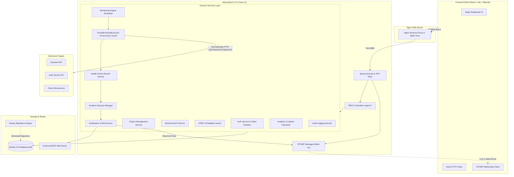
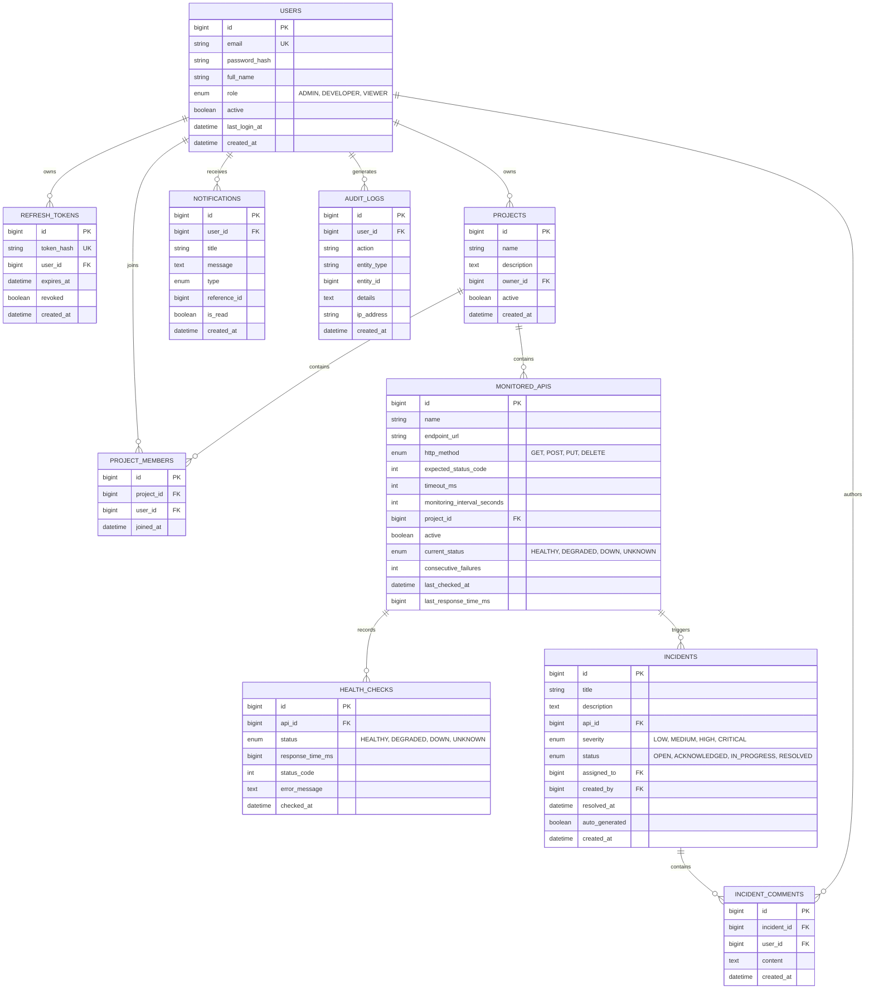
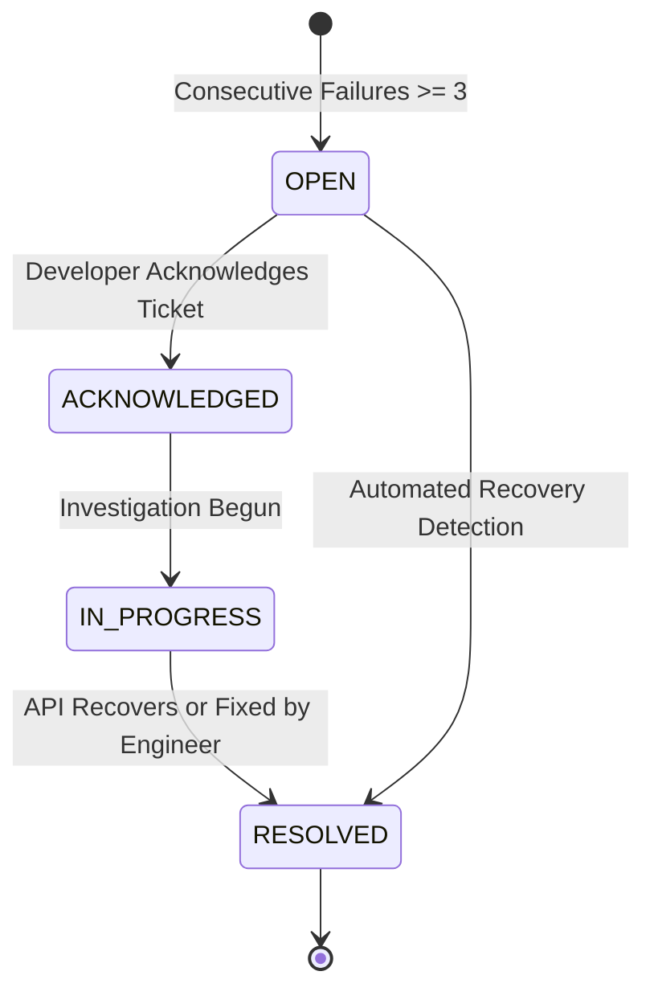

# Sentinel Architecture & System Design Documentation

## 1. High-Level System Architecture

Sentinel is built as a feature-based modular monolith in **Java 21** with **Spring Boot 3.x** and **MySQL 8.0**, paired with a **React + TypeScript + Vite + Tailwind CSS** enterprise dashboard. Real-time observability events are streamed using **Spring WebSocket (STOMP over SockJS)**.

---

## 2. Entity-Relationship (ER) Diagram

---

## 3. Incident Lifecycle State Transition

---

## 4. SSRF Defense Guard Architecture

Before any endpoint URL is stored or probed, it passes through `UrlValidator`:
1. **Scheme Validation:** Only `http://` and `https://` are permitted. Schemes like `file://`, `ftp://`, `gopher://` are rejected.
2. **Loopback & Localhost Rejection:** URLs targeting `localhost`, `127.0.0.1`, `::1`, `0.0.0.0`, `*.localhost` are blocked.
3. **Cloud Metadata Endpoint Defense:** Endpoints targeting `169.254.169.254`, `metadata.google.internal`, or `*.internal` are rejected.
4. **DNS Resolution Check:** Resolves destination IP via `InetAddress.getByName()` to detect and block RFC-1918 private subnets (`10.0.0.0/8`, `172.16.0.0/12`, `192.168.0.0/16`), link-local, and multicast addresses.

---

## 5. Non-Blocking Synthetic Probe Model

To prevent thread exhaustion and latency cascading:
1. Probes are executed outside of database transactions (`@Transactional`).
2. Concurrent checks run on a bounded `ThreadPoolTaskExecutor` (10 core, 20 max threads, bounded queue).
3. Per-API in-memory lock table (`ConcurrentHashMap<Long, Boolean>`) guarantees that a slow endpoint never triggers overlapping concurrent probes for the same API.
4. Probe results are written to `health_checks` and evaluated asynchronously for incident creation and WebSocket dispatches.

